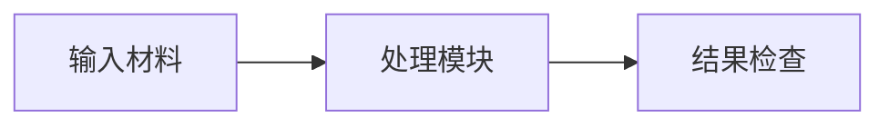

# Render a figure in Campus style

Run `scripts/render.mjs` from the repository root. It produces a PDF, an SVG
with embedded fonts, a 2x PNG preview and a JSON report. Node is needed for
this rendering command.

## Select the actual profile and runtime

Use the supplied profile and font overrides. `general` is the default;
select `tsinghua`, `pcl`, or a custom profile explicitly. The helper reads that
profile's literal HTML, RGB, RGB/cmyk or rgb `maincolor` definition. A computed
TeX color expression needs an explicit adaptation rather than a guessed color.

Default typography is **Carlito + FandolHei**, **14.6 CSS px**, approximately
11 TeX pt after browser PDF export (1 CSS px = 0.75 PDF bp). Match a changed talk
font or size with render settings.

Reuse a local Mermaid CLI runtime and Chrome/Chromium. `--runtime` is the package
prefix containing `node_modules/`; `--browser` is the actual browser executable.
Inspect versions: the CLI and Mermaid engine have separate version numbers.
If installation is needed and authorized, a tested pair is
`@mermaid-js/mermaid-cli@11.12.0` and `mermaid@11.17.2`. Install to an ignored local
directory, save the lock file, and reuse an existing browser.

## Generate

Create the source from the supplied diagram content, for example:



Save it as `materials/diagrams/process.mmd`, then run (substitute existing paths):

```bash
node .agents/skills/campus-mermaid/scripts/render.mjs \
  --input materials/diagrams/process.mmd \
  --output materials/diagrams/process \
  --profile general \
  --runtime build/mermaid-runtime \
  --browser /path/to/chrome
```

The output prefix has no extension. The report records the command, versions,
profile, dimensions, computed text sizes, actual fonts and clipping. Use
`--config-only` without a browser to inspect settings, and `--help` for font-file
and size overrides. `--no-sandbox` is an explicit opt-in for an environment that
requires that browser flag; normal launches keep the browser's own sandbox.

The renderer preloads fonts **before** Mermaid measures labels. Installing a font
or declaring `fontFamily` does not prove it was used: inspect the report and PNG.
Keep diagram-level overrides limited to layout or meaningful semantics rather
than overriding the shared palette or typography.

## Inspect the rendered files

Inspect the PNG or SVG together with the JSON report. SVG bounds checks cannot
detect every overlap or a label clipped inside its node. Check labels, wrapping,
connections and contrast visually. Confirm the actual fonts and computed text
sizes, especially for diagram types with specialized typography settings.
