<div align="center">
  <h1>
    <picture>
      <source media="(prefers-color-scheme: dark)" srcset="assets/campus-beamer-logo-white.svg">
      
    </picture>
  </h1>
  <h2>A clean, elegant academic Beamer template for AI agents</h2>
  <p>
    <a href="https://github.com/AnikiFan/campus-beamer/releases/latest"></a>
    <a href="https://github.com/AnikiFan/campus-beamer/actions/workflows/ci.yml"></a>
    <a href="LICENSE"></a>
    <a href="https://github.com/AnikiFan/campus-beamer/releases"></a>
  </p>
  <p>Give an agent your ideas and prepared materials; get a complete PDF and PowerPoint with speaker notes.</p>
  <p>
    <a href="README.md">中文</a> ·
    <a href="docs/usage.md">User guide (Chinese)</a> ·
    <a href="CONTRIBUTING.md">Contributing</a> ·
    <a href="docs/releases.md">Releases</a>
    <br>
    <a href="SECURITY.md">Security</a> ·
    <a href="ACCESSIBILITY.md">Accessibility</a> ·
    <a href="#acknowledgements">Acknowledgements</a>
  </p>
</div>

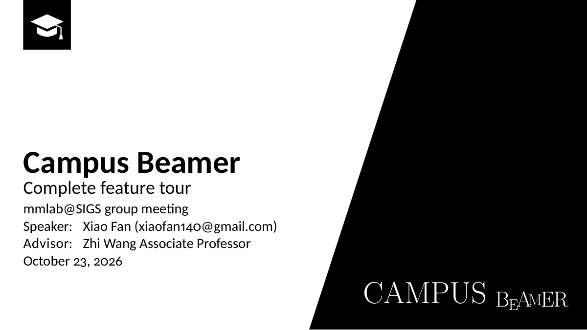

## English general example

[`example-en.tex`](example-en.tex) is the complete **English general-theme feature tour**:
English slide text, navigation labels, bibliography examples and native TeX speaker notes.
It follows the same five chapters and 50-page sequence as the Chinese demo and uses
`language=english, cjk=false`, so no Chinese typesetting is needed for this entry.

Build its PDF from the project root:

```bash
make pdf MAIN=example-en
# Render all pages for inspection:
make draft MAIN=example-en
```

The output is `build/example-en.pdf`. On [GitHub Releases](https://github.com/AnikiFan/campus-beamer/releases/latest),
choose **`campus-beamer-X.Y.Z-example-en.pdf`** for the English edition.
Releases include this English PDF only; the existing Chinese general edition supplies PDF and PPTX.
The comparison below uses the English General demo and the Chinese institution demos.

## Example pages

`example.tex` is the layout and feature tour. Download
the Chinese general theme's PDF/PPTX feature tour, the English general PDF, and the Tsinghua and Peng Cheng Laboratory PDF samples
from the [GitHub Releases](https://github.com/AnikiFan/campus-beamer/releases)
page. The example PPTX includes per-slide PowerPoint speaker notes. Advance through
the PDF/PPTX to see cumulative reveals and content replacement, with notes for each stage.
Compare each theme's cover, section, body and closing layouts below. Click a thumbnail to enlarge it;
download the corresponding PDF for the complete tour and interactive examples.

<!-- demo-gallery:start -->

<table>
  <thead>
    <tr>
      <th nowrap>Theme</th>
      <th nowrap>Cover</th>
      <th nowrap>Section</th>
      <th nowrap>Body</th>
      <th nowrap>Closing</th>
    </tr>
  </thead>
  <tbody>
    <tr>
      <th scope="row" nowrap><a href="theme/general/README.md">General</a></th>
      <td nowrap><a href="docs/images/preview-general-en-cover.png"></a></td>
      <td nowrap><a href="docs/images/preview-general-en-section.png">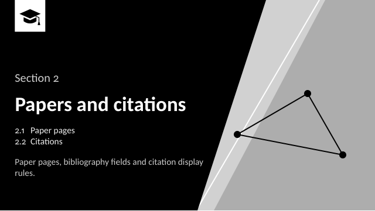</a></td>
      <td nowrap><a href="docs/images/preview-general-en-body.png">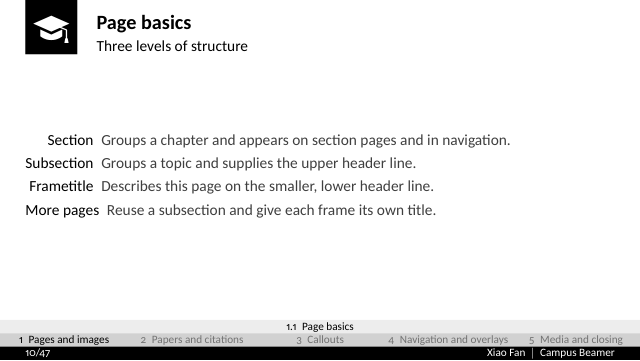</a></td>
      <td nowrap><a href="docs/images/preview-general-en-closing.png">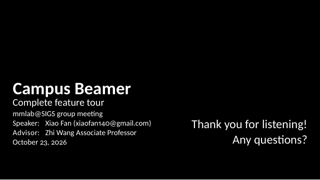</a></td>
    </tr>
    <tr>
      <th scope="row" nowrap><a href="theme/tsinghua/README.md">Tsinghua</a></th>
      <td nowrap><a href="docs/images/preview-tsinghua-cover.png"></a></td>
      <td nowrap><a href="docs/images/preview-tsinghua-section.png"></a></td>
      <td nowrap><a href="docs/images/preview-tsinghua-body.png">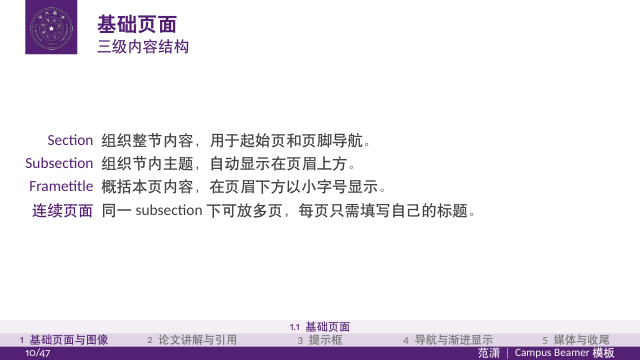</a></td>
      <td nowrap><a href="docs/images/preview-tsinghua-closing.png"></a></td>
    </tr>
    <tr>
      <th scope="row" nowrap><a href="theme/pcl/README.md">PCL</a></th>
      <td nowrap><a href="docs/images/preview-pcl-cover.png"></a></td>
      <td nowrap><a href="docs/images/preview-pcl-section.png"></a></td>
      <td nowrap><a href="docs/images/preview-pcl-body.png">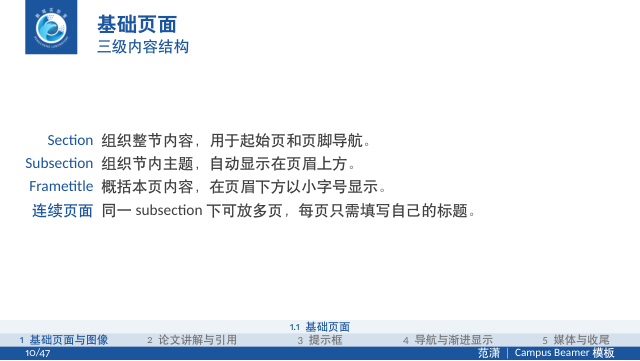</a></td>
      <td nowrap><a href="docs/images/preview-pcl-closing.png"></a></td>
    </tr>
  </tbody>
</table>

### Shared features

All themes share these features; the examples below use General.

<table>
  <tr>
    <th nowrap>Flowcharts</th>
    <th nowrap>Equations</th>
    <th nowrap>Code</th>
  </tr>
  <tr>
    <td><a href="docs/images/preview-general-en-flow.png">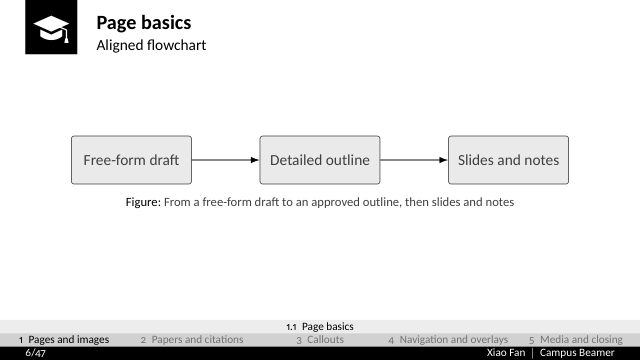</a></td>
    <td><a href="docs/images/preview-general-en-layout.png">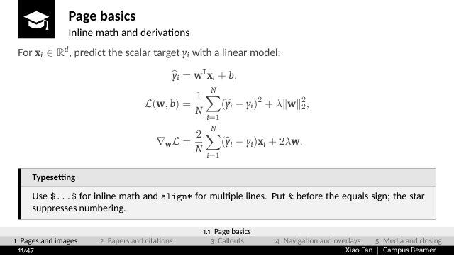</a></td>
    <td><a href="docs/images/preview-general-en-code.png">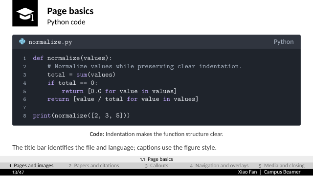</a></td>
  </tr>
  <tr>
    <th nowrap>Text and images</th>
    <th nowrap>Citations</th>
    <th nowrap>Callouts</th>
  </tr>
  <tr>
    <td><a href="docs/images/preview-general-en-fullheight.png">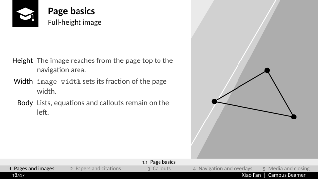</a></td>
    <td><a href="docs/images/preview-general-en-citations.png">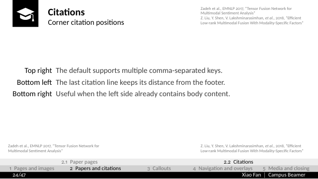</a></td>
    <td><a href="docs/images/preview-general-en-callouts.png">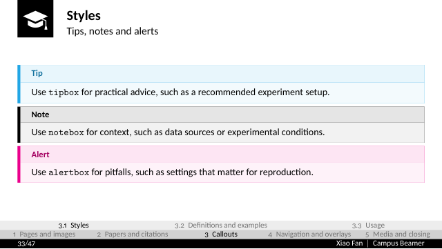</a></td>
  </tr>
</table>

<!-- demo-gallery:end -->

Previews are rendered for screen display, capped at **0.25 MiB (256 KiB) per image** and 3 MiB across both languages.
The full PDFs retain the original detail. The emblems,
wordmarks and campus images follow the [asset source and rights notice](assets/README.md).

The institution-neutral `general` profile is the default; select it explicitly with
`\documentclass[theme=general]{campusbeamer}`. Its editable icon, transparent project
wordmarks, colors and provenance live in [`theme/general/`](theme/general/README.md).
The shared implementation uses the neutral `campus` name.
`example.tex` demonstrates the layouts and features; the agent creates your presentation from your brief.
This is not an official university template.

## Download theme assets

Extract your chosen Release's `campus-beamer-*-source.zip`; the default general theme is ready to use.
Tsinghua and PCL each maintain their own latest asset bundle, separate from template versions.
Run only the command for the theme you need from the project root:

```bash
make theme-assets THEME=tsinghua
# For Peng Cheng Laboratory:
make theme-assets THEME=pcl
```

Only Python 3.10+ is needed. The command downloads that theme, verifies SHA-256 and installs it
under `theme/<theme>/assets/`. Complete local assets are reused without network access;
Git clones normally already include them. Documentation previews remain in the source ZIP.
The [Tsinghua](https://github.com/AnikiFan/campus-beamer/releases/tag/theme-assets-tsinghua) and
[PCL](https://github.com/AnikiFan/campus-beamer/releases/tag/theme-assets-pcl) bundles update independently.
See [installation instructions](docs/installation.md#机构主题素材) for explicit updates and manual downloads.

## Recommended workflow: ideas and local materials

1. Clone the repository or extract the source ZIP, then open the project with an agent that supports local file access and command execution.
2. Put prepared materials in `materials/`: for example an arXiv LaTeX source archive, a paper PDF, figures or your own results.
3. Fill in the basic information in the root [`outline.md`](outline.md), then write your ideas in the draft area using prose, notes or a section list. Include goals, material paths and speaking preferences as useful.
4. Ask the agent:

> Make a presentation from the outline.

The agent follows [`AGENTS.md`](AGENTS.md), reads the draft and materials, and develops a detailed outline with substantive content for each section and subsection.
It expands key points, explanations, evidence and the narrative for your review. Content development and restructuring happen at this stage.
After confirmation, it composes pages, distributes content between slides and notes, checks the layout and exports `build/main.pdf` and `build/main.pptx`.

The agent uses the repository's [authoring, validation and Mermaid Agent Skills](docs/usage.md#内置-agent-skills)
for the corresponding tasks.

[`STYLE.md`](STYLE.md) defines the default presentation style. **Edit it to suit your needs:**
slide density, the split between slides and notes, note detail, citation placement and date formatting.
The agent applies these preferences when authoring and revising; explicit requirements in the current outline take precedence.
It also unpacks paper source archives and reads the text, captions, figures and bibliography.
Outline development follows the talk's goals and supplied materials. External research, new assets or changes to facts are collected as questions for your confirmation.

Content revisions return to the detailed outline for confirmation before updating slides and notes.
During production, the agent can split frames, condense wording and adjust layouts within the approved content and time budget.

Speaker notes live in native TeX `\note` commands. The default `shownotes=false`
PDF contains slides only; `shownotes=true` adds a right-hand notes screen. PPTX
exports include speaker notes in either mode. See [native notes](docs/usage.md#原生讲者备注).

PPTX exports automatically include native sections and document properties: title,
author, subtitle, group, advisor and presentation date.

**PPTX slides are rendered images, not editable native PowerPoint text.**
Give edits to the agent or edit the generated `.tex` source.
Make compiles and converts existing content; the agent performs the writing.

Beamer overlays can reveal content in meaningful stages. PPTX exports preserve each stage
and explicit fade/dissolve transitions; see [progressive reveals](docs/usage.md#逐步显示与换页效果).

## Environment and reference example

The build environment needs GNU Make, uv, XeLaTeX, latexmk, biber and the template's TeX packages/fonts.
Use TeX Live / MacTeX or the [Docker environment](docs/docker.md).
See [installation instructions](docs/installation.md). Set up the environment once;
the agent can check the existing tools. `uv run --frozen` creates `.venv` from
`uv.lock`; the initial dependency download needs network access.

```bash
make doctor              # Check tools, TeX packages and fonts
make draft MAIN=example  # Inspect reference-example pages and layout report
make pdf MAIN=example-en # English general PDF
make MAIN=example        # build/example.pdf and build/example.pptx
make examples            # Build Tsinghua and Peng Cheng Laboratory PDFs
make theme-previews      # Refresh theme matrix and shared features (at most 0.25 MiB each)
make                     # Build main.tex if present; otherwise example.tex
```

[`example.tex`](example.tex) is a reference for people and agents. Its content
under `examples/sections/` demonstrates section pages, figures, equations, citations,
consistent captions, code windows, progressive reveals, navigation, video and TeX
speaker notes. The agent chooses useful layouts and creates
your content separately. The example also lists all public class options and
defaults; see [class options](docs/class-options.md).

- Fixed 16:9 layout with Chinese and English support; full primary-color section pages by default (black in general, purple in Tsinghua and blue in PCL).
- `\sectiontocpage[overview]` shows all sections uniformly; [focus frames](docs/usage.md#简洁页面与图片背景) use a single header/footer row and optional centered image backgrounds with cover scaling and adjustable opacity.
- Fitted figures, equations, paper walkthroughs and [terminal-style code windows](docs/usage.md#代码与终端窗口).
- `biblatex` / `biber`, corner citations and cited references; optional [DBLP and citation-count tools](docs/literature.md).
- [Web source references](docs/usage.md#网页来源引用) show the source name and actual URL in the shared corner-citation style.
- PDF-to-PPTX export preserving navigation, external links, embedded local video and per-page notes. Video poster previews in both PDF and PPTX need FFmpeg.
- `make draft` page previews and diagnostics for density, alignment and overflow review.

<details>
<summary>See corner citations and navigation</summary>


</details>

Use `materials/` for personal source material and `build/` for outputs. Personal talk source, materials and notes stay local by default;
see the [user guide](docs/usage.md#快速开始) for directory and distribution rules.
See [environment workflows](docs/workflows.md) for VS Code, Overleaf and the command line.

## Another university or research institute

Built-in profiles are `general` (default), `tsinghua` and `pcl` (Peng Cheng Laboratory).
Select the latter with `\documentclass[theme=pcl]{campusbeamer}`; see its
[profile and asset provenance](theme/pcl/README.md).

Copy `theme/general/` to `theme/myschool/`, edit its `profile.tex` and assets, then
select `theme=myschool` in the document class. No theme registry or shared-code edits are needed
for local use. See [theme setup and extension](theme/README.md).

Each profile defines functional colors (`maincolor`, `tipcolor`,
`notecolor`, `alertcolor`, `examplecolor`, `definitioncolor`) and paths to transparent
emblems/wordmarks. Pass campus photo and illustration
paths directly in your section files. Section backgrounds can also be `primary`,
`white`, or empty. Demo metadata lives in `examples/sections/metadata.tex`; the agent writes
your metadata in `sections/metadata.tex`.
Layout geometry stays in the theme implementation.
The footer uses `maincolor` with white text. The cover uses the primary-color diagonal layout,
with its color taken from `maincolor`; the explicit setting is `\titlebackground{primary}`.

## Development

```bash
make test          # Python regression tests
make check-theme   # Compile theme fixtures in isolation
make dist          # Standalone source ZIP, without generated output
make version       # Project version from pyproject.toml
make release       # Test, build the public demo and bundle checksummed release artifacts
make clean         # Manually remove intermediates after a failed build
make help
```

Document-class, theme and school-profile files live in `theme/`. Keep this directory
and `.latexmkrc` when copying the template: latexmk configures the TeX search path,
so `\documentclass{campusbeamer}` and the Make commands remain unchanged.
Your presentation uses `main.tex`, `sections/` for metadata and chapters, and
`bibliography/` for references. Public demo content lives separately in
`examples/sections/` and `examples/bibliography/`, with `example.tex` as its entry.
Documentation lives in `docs/`, and test sources in `tools/fixtures/`.
Local output lives in ignored `build/` directories.
GitHub Actions reads `.github/workflows/` from the repository root.
See [CONTRIBUTING.md](CONTRIBUTING.md) for bug reports and pull requests.

Track public changes in [CHANGELOG.md](CHANGELOG.md). Source ZIPs include only
the individually reviewed files in `tools/package_source.py`; new files are
excluded by default. `make release` creates
`build/releases/campus-beamer-v<version>-release.zip` as a local checksummed bundle.
GitHub Releases expose the source ZIP, the general feature tour as PDF/PPTX,
the Tsinghua and Peng Cheng Laboratory samples as PDF, release notes
and SHA-256 checksums as separate downloadable assets. It builds the three public entries independently of any local `main.tex`.
The **Release Please** GitHub workflow maintains release
PRs, creates releases and uploads bundles after merging, with a manual build
entry point as well. See the [release guide](docs/releases.md) for setup and publishing.

## License and assets

Source code uses **GPL-3.0-or-later**; see [LICENSE](LICENSE). Asset terms are documented by theme:

- **General**: the original graduation cap, geometric background and project lettering source use
  GPL-3.0-or-later. The Latin Modern font retains its GUST Font License. See the
  [general asset notice](theme/general/README.md) and [project lettering notice](assets/README.md#campus-beamer-项目字标).
- **Tsinghua**: the emblem, university name, combined marks and campus images come from the
  university's visual identity system and the SIGS official photo gallery; some are cropped.
  See the [Tsinghua sources, file list and notice](theme/tsinghua/README.md).
- **Peng Cheng Laboratory**: the emblem comes from the Shenzhen government's Hetao website;
  lettering and campus images come from PCL's official website, campus gallery and recruitment site.
  Derived assets include cropping, format conversion and lettering adapted for dark backgrounds.
  See the [PCL sources, file list and notice](theme/pcl/README.md).

Tsinghua and PCL marks and images remain subject to their rights holders' trademarks,
copyrights and other rights. They are provided only for this template's presentation purposes,
are not covered by the project's GPL license, and imply no institutional authorization or endorsement.
Explicit permissions and individual photographer credits for these institutional assets
have not been obtained or verified. For rights, credit or attribution concerns, contact
[xiaofan140@gmail.com](mailto:xiaofan140@gmail.com) or open a repository Issue. We will review
reports and add credits, correct notices, replace or remove affected assets. This contact notice
does not replace permission. Assets in PDF, PPTX and README previews retain the same terms.

The original procedural video `assets/presentation_demo.mp4` is separately dedicated under
**CC0-1.0**; see its [source and dedication](assets/README.md#原创演示视频).

## Acknowledgements

Thanks to the authors and contributors of these projects:

- **Build environment**: [xu-cheng/latex-docker](https://github.com/xu-cheng/latex-docker).
  This project's Docker environment extends its Debian image with preinstalled TeX Live,
  adding template fonts and PDF/PPTX tools.
- **Engineering practices**: [TongjiThesis](https://github.com/TJ-CSCCG/TongjiThesis).
  Its document-class options, bibliography interface, chapter organization, Make workflow,
  environment checks and guidance for the command line, VS Code, Overleaf and GitHub Actions
  informed this project's independent implementation for Beamer presentations.
- **Visual style**: [THU-beamer-template](https://github.com/FangWHao/THU-beamer-template)
  and [TongjiBeamer](https://github.com/Kian-Chen/TongjiBeamer). This template's style builds
  on both projects, with further adjustments for its layout and presentation features.
- **Early template origins**: [college-beamer](https://github.com/liu-qilong/college-beamer)
  and Federico Zenith's [SINTEF Presentation](https://www.overleaf.com/latex/templates/sintef-presentation/jhbhdffczpnx).
  This template's early foundations trace back to these projects; college-beamer also explicitly
  credits SINTEF Presentation as its basis.
