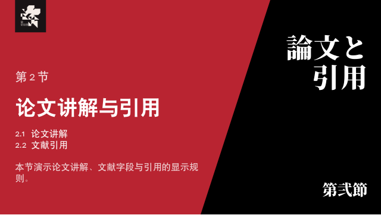
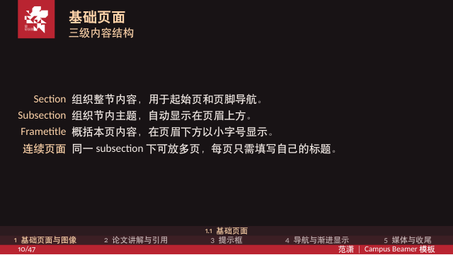
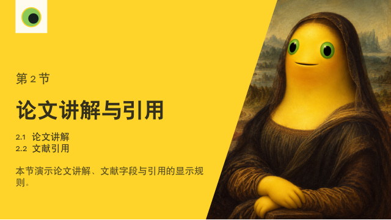
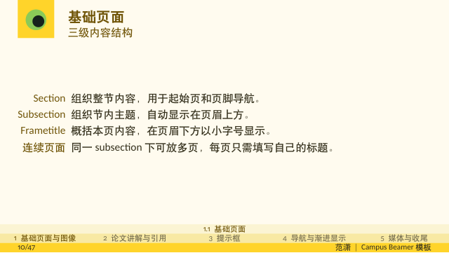
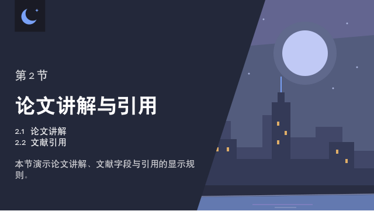
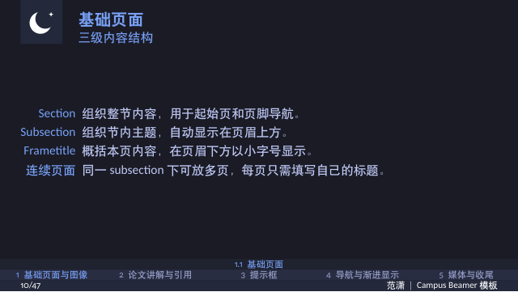

<div align="center">
  <h1>
    <picture>
      <source media="(prefers-color-scheme: dark)" srcset="assets/campus-beamer-logo-white.svg">
      
    </picture>
  </h1>
  <h2>A clean, elegant academic Beamer template for AI agents</h2>
  <p>
    <a href="https://github.com/AnikiFan/campus-beamer/releases/latest"></a>
    <a href="https://github.com/AnikiFan/campus-beamer/actions/workflows/ci.yml"></a>
    <a href="LICENSE"></a>
    <a href="https://github.com/AnikiFan/campus-beamer/releases"></a>
  </p>
  <p>Give an agent your ideas and prepared materials; get a complete PDF and PowerPoint with speaker notes.</p>
  <p>
    <a href="README.md">中文</a> ·
    <a href="docs/usage.md">User guide (Chinese)</a> ·
    <a href="CONTRIBUTING.md">Contributing</a> ·
    <a href="docs/releases.md">Releases</a>
    <br>
    <a href="SECURITY.md">Security</a> ·
    <a href="ACCESSIBILITY.md">Accessibility</a> ·
    <a href="#acknowledgements">Acknowledgements</a>
  </p>
</div>


LaTeX produces the PDF; PPTX preserves the rendered pages, links, video and speaker notes.
**Each PPTX slide is an image: its text is not editable as native PowerPoint text.**
Edit the TeX source or ask your agent to revise it, then export again. This is not an official university template.

## Quick start

Run commands from the project root containing `Makefile`. Detailed manuals and theme notices are primarily in Chinese.

### Create your own presentation

1. Clone the repository or extract a [Release source archive](https://github.com/AnikiFan/campus-beamer/releases), then open it in an agent that can read local files and run commands.
2. Run `make init` to create a local `outline.md` without overwriting an existing draft. Fill in your brief and put papers, figures and results in `materials/`.
3. Ask the agent to **create a presentation from the outline**. It follows [AGENTS.md](AGENTS.md), reads your materials and develops `build/outline-normalized.md` for your confirmation.
4. After confirmation, it arranges slides and native TeX notes, checks the layout and exports `build/main.pdf` and `build/main.pptx`.

See the [starter outline](tools/templates/outline.md) for the fields and [STYLE.md](STYLE.md) for editable writing and layout preferences.
Content revisions return to outline review; layout changes stay within the approved content. External research, new assets and factual changes require confirmation.
The local outline, `main.tex`, `sections/`, `materials/` and personal bibliography are ignored by Git.
Before updating an older clone, back up any outline you have filled in.

### Build the reference example locally

Install **GNU Make, Python 3.10+, uv, XeLaTeX, latexmk, biber** and the template fonts.
Local video previews and embedding also require FFmpeg. See [installation](docs/installation.md) or the [Docker environment](docs/docker.md).

```bash
make doctor
make draft MAIN=examples/example-en  # English PDF and page previews
make MAIN=examples/example           # Chinese general PDF + PPTX
```

`uv run --frozen` prepares the locked Python environment; first-time dependency downloads need network access.
For ready-made examples, visit [Releases](https://github.com/AnikiFan/campus-beamer/releases).
Choose `campus-beamer-X.Y.Z-example-en.pdf` for English. Releases provide Chinese general as PDF/PPTX and English general and other themes as PDF.
The English entry is [`examples/example-en.tex`](examples/example-en.tex); it uses `language=english,cjk=false` and includes English notes.

### Edit a PDF in Overleaf

Preparing the import ZIP needs only **GNU Make and Python 3.10+**, without local LaTeX or uv:

```bash
make overleaf OVERLEAF_LANGUAGE=english
make overleaf THEME=eva OVERLEAF_LANGUAGE=english
make overleaf OVERLEAF_LANGUAGE=english ASPECTRATIO=43
```

Upload the ZIP from `build/overleaf/` as a new project, selecting `main.tex` and **XeLaTeX**.
The package starts from the public demo and downloads missing theme assets automatically.
See [Overleaf editing and local PPTX export](docs/workflows.md#overleaf-中编辑-pdf) for details and compilation limits.
Online Overleaf compilation has not yet been tested by this project.

## Example pages

Compare covers, section pages, body slides and closing pages below; click a thumbnail to enlarge it.
The General row and shared features use the English demo; other theme rows use their Chinese demos.
The complete examples cover math, code, citations, overlays, navigation, video and native notes.

<!-- demo-gallery:start -->

<table>
  <thead>
    <tr>
      <th nowrap>Theme</th>
      <th nowrap>Cover</th>
      <th nowrap>Section</th>
      <th nowrap>Body</th>
      <th nowrap>Closing</th>
    </tr>
  </thead>
  <tbody>
    <tr>
      <th scope="row" nowrap><a href="theme/general/README.md">General</a></th>
      <td nowrap><a href="docs/images/preview-general-en-cover.png"></a></td>
      <td nowrap><a href="docs/images/preview-general-en-section.png"></a></td>
      <td nowrap><a href="docs/images/preview-general-en-body.png"></a></td>
      <td nowrap><a href="docs/images/preview-general-en-closing.png"></a></td>
    </tr>
    <tr>
      <th scope="row" nowrap><a href="theme/eva/README.md">EVA</a></th>
      <td nowrap><a href="docs/images/preview-eva-cover.png"></a></td>
      <td nowrap><a href="docs/images/preview-eva-section.png"></a></td>
      <td nowrap><a href="docs/images/preview-eva-body.png"></a></td>
      <td nowrap><a href="docs/images/preview-eva-closing.png"></a></td>
    </tr>
    <tr>
      <th scope="row" nowrap><a href="theme/undefined/README.md">undefined</a></th>
      <td nowrap><a href="docs/images/preview-undefined-cover.png"></a></td>
      <td nowrap><a href="docs/images/preview-undefined-section.png"></a></td>
      <td nowrap><a href="docs/images/preview-undefined-body.png"></a></td>
      <td nowrap><a href="docs/images/preview-undefined-closing.png"></a></td>
    </tr>
    <tr>
      <th scope="row" nowrap><a href="theme/tokyo-night/README.md">Tokyo Night</a></th>
      <td nowrap><a href="docs/images/preview-tokyo-night-cover.png"></a></td>
      <td nowrap><a href="docs/images/preview-tokyo-night-section.png"></a></td>
      <td nowrap><a href="docs/images/preview-tokyo-night-body.png"></a></td>
      <td nowrap><a href="docs/images/preview-tokyo-night-closing.png"></a></td>
    </tr>
    <tr>
      <th scope="row" nowrap><a href="theme/tsinghua/README.md">Tsinghua</a></th>
      <td nowrap><a href="docs/images/preview-tsinghua-cover.png"></a></td>
      <td nowrap><a href="docs/images/preview-tsinghua-section.png"></a></td>
      <td nowrap><a href="docs/images/preview-tsinghua-body.png"></a></td>
      <td nowrap><a href="docs/images/preview-tsinghua-closing.png"></a></td>
    </tr>
    <tr>
      <th scope="row" nowrap><a href="theme/pcl/README.md">PCL</a></th>
      <td nowrap><a href="docs/images/preview-pcl-cover.png"></a></td>
      <td nowrap><a href="docs/images/preview-pcl-section.png"></a></td>
      <td nowrap><a href="docs/images/preview-pcl-body.png"></a></td>
      <td nowrap><a href="docs/images/preview-pcl-closing.png"></a></td>
    </tr>
  </tbody>
</table>

### Shared features

All themes share these features; the examples below use General.

<table>
  <tr>
    <th nowrap>Flowcharts</th>
    <th nowrap>Equations</th>
    <th nowrap>Code</th>
  </tr>
  <tr>
    <td><a href="docs/images/preview-general-en-flow.png"></a></td>
    <td><a href="docs/images/preview-general-en-layout.png"></a></td>
    <td><a href="docs/images/preview-general-en-code.png"></a></td>
  </tr>
  <tr>
    <th nowrap>Text and images</th>
    <th nowrap>Citations</th>
    <th nowrap>Callouts</th>
  </tr>
  <tr>
    <td><a href="docs/images/preview-general-en-fullheight.png"></a></td>
    <td><a href="docs/images/preview-general-en-citations.png"></a></td>
    <td><a href="docs/images/preview-general-en-callouts.png"></a></td>
  </tr>
</table>

<!-- demo-gallery:end -->

## Choose and customize a theme

The institution-neutral `general` theme is the default. Select another with `\documentclass[theme=eva]{campusbeamer}`.

| Theme | Appearance and use | Complete example entry |
| --- | --- | --- |
| [general](theme/general/README.md) | Black and white, original graduation cap and project lettering | `examples/example` |
| [tokyo-night](theme/tokyo-night/README.md) | Dark surfaces and a night palette | `examples/example-tokyo-night` |
| [undefined](theme/undefined/README.md) | Naiwa yellow, single-eye icon and painting parodies | `examples/example-undefined` |
| [eva](theme/eva/README.md) | Unit-02-inspired red and black, fragmented NERV emblem from Evangelion: 3.0, Japanese title cards and a final “終。” card | `examples/example-eva` |
| [tsinghua](theme/tsinghua/README.md) | Tsinghua marks and campus images | `examples/example-tsinghua` |
| [pcl](theme/pcl/README.md) | Peng Cheng Laboratory marks and campus images | `examples/example-pcl` |

Run `make pdf MAIN=examples/example-eva` for a selected demo; `make examples` builds all non-default theme PDFs.
To add a local theme, copy `theme/general/`, then edit its `profile.tex` and assets. No changes to shared code are needed.
See [theme configuration](theme/README.md); each theme page documents its assets and usage terms.

### Download theme assets

Release `campus-beamer-*-source.zip` archives include general assets. Other themes use independent bundles:

```bash
make theme-assets THEME=eva
# Also available: tokyo-night, undefined, tsinghua, pcl.
```

This requires GNU Make and Python 3.10+. Downloads are checked with SHA-256; complete local assets are reused offline.
Git clones normally already contain the assets. See [asset installation](docs/installation.md#主题素材) for manual downloads, updates and installation records.

## Aspect ratio

The default is 16:9. Use `\documentclass[aspectratio=43]{campusbeamer}` for 4:3 with any theme.

```bash
make pdf MAIN=examples/example-43      # Chinese general 4:3; included in Releases
make pdf MAIN=examples/example-eva-43  # EVA 4:3
make pdf MAIN=examples/example-en-43   # English general 4:3
```

Bundled illustrations are primarily cropped for 16:9. Check subject visibility and adjust crops for 4:3; content is not rewritten automatically.
See [class and aspect ratio options](docs/class-options.md#页面比例).

## Features and documentation

| Task | Guide |
| --- | --- |
| Set language, ratio, navigation and citation width | [Class options](docs/class-options.md) |
| Arrange images, equations, callouts and code | [User guide](docs/usage.md) |
| Write and export speaker notes | [Native TeX notes](docs/usage.md#原生讲者备注); edit `\note` |
| Reveal content in stages | [Overlays and transitions](docs/usage.md#逐步显示与换页效果) |
| Find literature and verify citation counts | [Literature tools](docs/literature.md) |
| Use VS Code, the terminal or Overleaf | [Environment workflows](docs/workflows.md) |
| Follow the authoring, validation or diagram workflow | [Built-in Agent Skills](docs/usage.md#内置-agent-skills) |

The default `shownotes=false` PDF contains only slides; `shownotes=true` adds a right-hand notes screen.
Both modes export notes to PPTX, along with native sections, title, author and presentation-date properties.

## Common commands

```bash
make init                       # Create a private outline; keep existing content
make                            # Build main.tex, or the public demo when absent
make pdf                        # PDF only
make DPI=200                    # Smaller PPTX for previews
make draft PAGES=3,8-10          # Preview selected pages and inspect layout
make literature QUERY="paper title"
make bibtex DBLP_KEY=conf/...    # Stage BibTeX and citation data for review
make clean                      # Remove TeX intermediates; keep final outputs
make help                       # List all targets
```

## Project files

```text
outline.md            Local brief created by make init
main.tex              Agent-authored presentation entry
sections/             Personal metadata, chapters and TeX notes
materials/            Papers, figures and results
bibliography/         Personal bibliography
examples/             Public feature and theme examples
theme/                Shared layout and theme configuration
STYLE.md              Editable presentation preferences
docs/                 Installation, usage and environment guides
build/                PDF, PPTX, notes PDF and previews
```

## Contributing

Reproducible issues, documentation improvements and themes with documented provenance are welcome.
Read [CONTRIBUTING.md](CONTRIBUTING.md), include a minimal example and relevant logs, and exclude private presentations, notes and materials.
See [CHANGELOG.md](CHANGELOG.md) for changes and [release maintenance](docs/releases.md) for the publishing workflow.

## License and assets

Source code uses **GPL-3.0-or-later**; see [LICENSE](LICENSE). Asset terms are documented by theme:

- **General**: the original graduation cap, geometric background and project lettering source use
  GPL-3.0-or-later. The Latin Modern font retains its GUST Font License. See the
  [general asset notice](theme/general/README.md) and [project lettering notice](assets/README.md#campus-beamer-项目字标).
- **Tokyo Night**: the original crescent-and-star icon, city illustration and project lettering
  adaptation use GPL-3.0-or-later. See the [Tokyo Night asset notice](theme/tokyo-night/README.md)
  for the upstream palette's MIT notice and font license.
- **EVA**: fragmented NERV emblem from Evangelion: 3.0, red palette and Japanese title cards; see the [emblem rights, substitute font and visual source notice](theme/eva/README.md).
- **undefined**: A Naiwa-inspired circular eye and AI-generated painting parodies. See the
  [asset provenance and rights notice](theme/undefined/README.md).
- **Tsinghua**: the emblem, university name, combined marks and campus images come from the
  university's visual identity system and the SIGS official photo gallery; some are cropped.
  See the [Tsinghua sources, file list and notice](theme/tsinghua/README.md).
- **Peng Cheng Laboratory**: the emblem comes from the Shenzhen government's Hetao website;
  lettering and campus images come from PCL's official website, campus gallery and recruitment site.
  Derived assets include cropping, format conversion and lettering adapted for dark backgrounds.
  See the [PCL sources, file list and notice](theme/pcl/README.md).

Tsinghua and PCL marks and images remain subject to their rights holders' trademarks,
copyrights and other rights. They are provided only for this template's presentation purposes,
are not covered by the project's GPL license, and imply no institutional authorization or endorsement.
Explicit permissions and individual photographer credits for these institutional assets
have not been obtained or verified. For rights, credit or attribution concerns, contact
[xiaofan140@gmail.com](mailto:xiaofan140@gmail.com) or open a repository Issue. We will review
reports and add credits, correct notices, replace or remove affected assets. This contact notice
does not replace permission. Assets in PDF, PPTX and README previews retain the same terms.

The original procedural video `assets/presentation_demo.mp4` is separately dedicated under
**CC0-1.0**; see its [source and dedication](assets/README.md#原创演示视频).

## Acknowledgements

Thanks to the authors and contributors of these projects:

- **Dark palette**: [Tokyo Night](https://github.com/tokyo-night/tokyo-night-vscode-theme) by Enkia (MIT).
  The `tokyo-night` profile adapts its night palette with brighter body, citation and navigation text
  for presentations; see the [source and license notice](theme/tokyo-night/README.md).
- **Build environment**: [xu-cheng/latex-docker](https://github.com/xu-cheng/latex-docker).
  This project's Docker environment extends its Debian image with preinstalled TeX Live,
  adding template fonts and PDF/PPTX tools.
- **Engineering practices**: [TongjiThesis](https://github.com/TJ-CSCCG/TongjiThesis).
  Its document-class options, bibliography interface, chapter organization, Make workflow,
  environment checks and guidance for the command line, VS Code, Overleaf and GitHub Actions
  informed this project's independent implementation for Beamer presentations.
- **Visual style**: [THU-beamer-template](https://github.com/FangWHao/THU-beamer-template)
  and [TongjiBeamer](https://github.com/Kian-Chen/TongjiBeamer). This template's style builds
  on both projects, with further adjustments for its layout and presentation features.
- **Early template origins**: [college-beamer](https://github.com/liu-qilong/college-beamer)
  and Federico Zenith's [SINTEF Presentation](https://www.overleaf.com/latex/templates/sintef-presentation/jhbhdffczpnx).
  This template's early foundations trace back to these projects; college-beamer also explicitly
  credits SINTEF Presentation as its basis.
