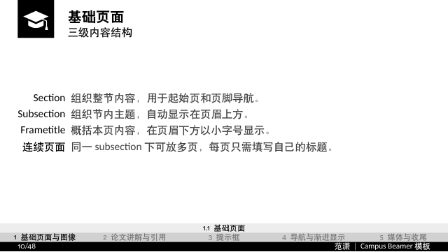
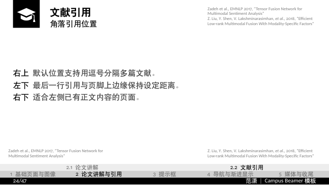

<div align="center">
  <h1>
    <picture>
      <source media="(prefers-color-scheme: dark)" srcset="assets/campus-beamer-logo-white.svg">
      
    </picture>
  </h1>
  <h2>简洁、优雅，面向 Agent 的学术 Beamer 模板</h2>
  <p>
    <a href="https://github.com/AnikiFan/campus-beamer/releases/latest"></a>
    <a href="https://github.com/AnikiFan/campus-beamer/actions/workflows/ci.yml"></a>
    <a href="LICENSE"></a>
    <a href="https://github.com/AnikiFan/campus-beamer/releases"></a>
  </p>
  <p>把思路和备好的素材交给 agent，生成排版完整、带讲解备注的 PDF 与 PowerPoint。</p>
  <p>
    <a href="README.en.md">English</a> ·
    <a href="docs/usage.md">使用手册</a> ·
    <a href="CONTRIBUTING.md">贡献指南</a> ·
    <a href="docs/releases.md">版本与发布</a>
    <br>
    <a href="SECURITY.md">安全政策</a> ·
    <a href="ACCESSIBILITY.md">无障碍说明</a> ·
    <a href="#致谢">致谢</a>
  </p>
</div>


PDF 由 LaTeX 排版，PPTX 保留页面外观、跳转、视频和讲者备注。
**PPTX 每页是一张渲染图像，文字不能作为 PowerPoint 原生文本编辑。**
修改内容应编辑 TeX 源码或交给 agent，再重新导出。本项目不是学校官方模板。

## 快速开始

所有命令从包含 `Makefile` 的项目根目录运行。

### 制作自己的汇报

1. 克隆仓库或解压 [Release 源码包](https://github.com/AnikiFan/campus-beamer/releases)，在支持本地文件读写和命令执行的 agent 中打开。
2. 运行 `make init` 创建本地 `outline.md`（已有文件不会被覆盖），填写基本信息与演讲思路；将论文、图片和实验结果放进 `materials/`。
3. 对 agent 说：**“根据大纲制作 PPT。”** 它按 [AGENTS.md](AGENTS.md) 阅读材料，扩充详细大纲到 `build/outline-normalized.md`，供你确认。
4. 确认后，agent 编排页面和原生 TeX 备注、检查排版，并导出 `build/main.pdf` 与 `build/main.pptx`。

[起始大纲](tools/templates/outline.md)展示可填写的字段。[STYLE.md](STYLE.md) 可调整内容密度、备注分工、引用与日期风格。
内容修订回到大纲确认；已确认范围内的拆页、精简和布局由 agent 完成。外部检索、新素材或事实修改需先确认。
`outline.md`、`main.tex`、`sections/`、`materials/` 和个人文献目录默认被 Git 忽略。
克隆旧版本升级时，先备份自己填写的大纲，再更新仓库。

### 本地查看功能示例

准备 **GNU Make、Python 3.10+、uv、XeLaTeX、latexmk、biber** 和模板字体；视频首帧及嵌入需要 FFmpeg。
具体步骤见[安装说明](docs/installation.md)，也可用 [Docker 环境](docs/docker.md)。

```bash
make doctor                       # 检查环境
make draft MAIN=examples/example   # PDF、逐页预览与排版报告
make MAIN=examples/example         # build/example.pdf 和 build/example.pptx
```

`uv run --frozen` 会按锁文件准备 Python 环境，首次下载依赖需要联网。
直接查看成品可到 [Releases](https://github.com/AnikiFan/campus-beamer/releases) 下载：中文 general 提供 PDF/PPTX，英文 general 及其他主题提供 PDF。
英文示例使用 `make pdf MAIN=examples/example-en`，输出 `build/example-en.pdf`。

### 在 Overleaf 中编辑 PDF

准备导入包只需 **GNU Make 和 Python 3.10+**，不需要本地 LaTeX 或 uv：

```bash
make overleaf                                      # general，中文，16:9
make overleaf THEME=eva                             # 选择主题
make overleaf OVERLEAF_LANGUAGE=english ASPECTRATIO=43
```

将 `build/overleaf/` 中的 ZIP 上传为新项目，选择 `main.tex` 和 **XeLaTeX**。
导入包从公开示例开始，缺少的主题素材会自动补齐。在线编辑、编译限制和本地 PPTX 导出见
[Overleaf 使用说明](docs/workflows.md#overleaf-中编辑-pdf)；本项目尚未完成 Overleaf 在线实测。

## 示例页面

下表比较各主题的封面、章节页、正文页和致谢页；点击图片可放大。
完整示例包括公式、代码、引用、逐步显示、导航、视频与原生讲者备注。

<!-- demo-gallery:start -->

<table>
  <thead>
    <tr>
      <th nowrap>主题</th>
      <th nowrap>封面</th>
      <th nowrap>章节页</th>
      <th nowrap>正文页</th>
      <th nowrap>致谢页</th>
    </tr>
  </thead>
  <tbody>
    <tr>
      <th scope="row" nowrap><a href="theme/general/README.md">通用</a></th>
      <td nowrap><a href="docs/images/preview-general-cover.png"></a></td>
      <td nowrap><a href="docs/images/preview-general-section.png"></a></td>
      <td nowrap><a href="docs/images/preview-general-body.png"></a></td>
      <td nowrap><a href="docs/images/preview-general-closing.png"></a></td>
    </tr>
    <tr>
      <th scope="row" nowrap><a href="theme/eva/README.md">EVA</a></th>
      <td nowrap><a href="docs/images/preview-eva-cover.png"></a></td>
      <td nowrap><a href="docs/images/preview-eva-section.png"></a></td>
      <td nowrap><a href="docs/images/preview-eva-body.png"></a></td>
      <td nowrap><a href="docs/images/preview-eva-closing.png"></a></td>
    </tr>
    <tr>
      <th scope="row" nowrap><a href="theme/undefined/README.md">undefined</a></th>
      <td nowrap><a href="docs/images/preview-undefined-cover.png"></a></td>
      <td nowrap><a href="docs/images/preview-undefined-section.png"></a></td>
      <td nowrap><a href="docs/images/preview-undefined-body.png"></a></td>
      <td nowrap><a href="docs/images/preview-undefined-closing.png"></a></td>
    </tr>
    <tr>
      <th scope="row" nowrap><a href="theme/tokyo-night/README.md">Tokyo Night</a></th>
      <td nowrap><a href="docs/images/preview-tokyo-night-cover.png"></a></td>
      <td nowrap><a href="docs/images/preview-tokyo-night-section.png"></a></td>
      <td nowrap><a href="docs/images/preview-tokyo-night-body.png"></a></td>
      <td nowrap><a href="docs/images/preview-tokyo-night-closing.png"></a></td>
    </tr>
    <tr>
      <th scope="row" nowrap><a href="theme/tsinghua/README.md">清华大学</a></th>
      <td nowrap><a href="docs/images/preview-tsinghua-cover.png"></a></td>
      <td nowrap><a href="docs/images/preview-tsinghua-section.png"></a></td>
      <td nowrap><a href="docs/images/preview-tsinghua-body.png"></a></td>
      <td nowrap><a href="docs/images/preview-tsinghua-closing.png"></a></td>
    </tr>
    <tr>
      <th scope="row" nowrap><a href="theme/pcl/README.md">鹏城实验室</a></th>
      <td nowrap><a href="docs/images/preview-pcl-cover.png"></a></td>
      <td nowrap><a href="docs/images/preview-pcl-section.png"></a></td>
      <td nowrap><a href="docs/images/preview-pcl-body.png"></a></td>
      <td nowrap><a href="docs/images/preview-pcl-closing.png"></a></td>
    </tr>
  </tbody>
</table>

### 公共功能精选

以下功能适用于全部主题，统一用 general 展示。

<table>
  <tr>
    <th nowrap>流程图</th>
    <th nowrap>公式</th>
    <th nowrap>代码</th>
  </tr>
  <tr>
    <td><a href="docs/images/preview-general-flow.png"></a></td>
    <td><a href="docs/images/preview-general-layout.png"></a></td>
    <td><a href="docs/images/preview-general-code.png"></a></td>
  </tr>
  <tr>
    <th nowrap>图文混排</th>
    <th nowrap>论文引用</th>
    <th nowrap>提示框</th>
  </tr>
  <tr>
    <td><a href="docs/images/preview-general-fullheight.png"></a></td>
    <td><a href="docs/images/preview-general-citations.png"></a></td>
    <td><a href="docs/images/preview-general-callouts.png"></a></td>
  </tr>
</table>

<!-- demo-gallery:end -->

## 选择与定制主题

默认使用与机构无关的 `general`。通过 `\documentclass[theme=eva]{campusbeamer}` 切换主题。

| 主题 | 外观与用途 | 完整示例入口 |
| --- | --- | --- |
| [general](theme/general/README.md) | 黑白通用主题，原创博士帽与项目字标 | `examples/example` |
| [tokyo-night](theme/tokyo-night/README.md) | 深色正文与夜间配色 | `examples/example-tokyo-night` |
| [undefined](theme/undefined/README.md) | 奶蛙黄色配色、单眼图标与名画配图 | `examples/example-undefined` |
| [eva](theme/eva/README.md) | 二号机联想的红黑配色、《Q》碎片化 NERV 标志与日文标题卡，最后一节以「終。」收尾 | `examples/example-eva` |
| [tsinghua](theme/tsinghua/README.md) | 清华大学标志与校园配图 | `examples/example-tsinghua` |
| [pcl](theme/pcl/README.md) | 鹏城实验室标志与园区配图 | `examples/example-pcl` |

运行 `make pdf MAIN=examples/example-eva` 可查看相应示例；`make examples` 构建所有非默认主题 PDF。
运行 `make theme-new THEME=my-theme` 创建自己的主题，修改 `profile.tex` 与素材后即可使用。
`make theme-preview THEME=my-theme` 可一次预览 16:9 和 4:3；欢迎按[主题贡献流程](CONTRIBUTING.md)分享。
配置方法见[主题使用与扩展](theme/README.md)，各主题页面提供素材来源与使用范围。

### 下载主题素材

Release 的 `campus-beamer-*-source.zip` 自带 general 素材；其他主题使用独立素材包：

```bash
make theme-assets THEME=eva
# 也可选择 tokyo-night、undefined、tsinghua 或 pcl。
```

命令需要 GNU Make 和 Python 3.10+，下载后校验 SHA-256；已有完整素材时不联网。
Git 克隆通常已包含素材。手动下载、显式更新及安装记录见[素材安装说明](docs/installation.md#主题素材)。

## 页面比例

默认 16:9；4:3 使用 `\documentclass[aspectratio=43]{campusbeamer}`，可与任意主题组合。

```bash
make pdf MAIN=examples/example-43       # general 中文 4:3，Release 提供此 PDF
make pdf MAIN=examples/example-eva-43   # EVA 4:3
make pdf MAIN=examples/example-en-43    # general 英文 4:3
```

随附插图主要按 16:9 裁剪，4:3 下应检查主体与取景并调整裁切；文字内容不会自动改写。
全部选项见[文档类与页面比例](docs/class-options.md#页面比例)。

## 功能与文档

| 需要做什么 | 说明 |
| --- | --- |
| 设置语言、比例、导航与引用宽度 | [文档类选项](docs/class-options.md) |
| 安排图文、公式、提示框与代码 | [使用手册](docs/usage.md) |
| 编写与导出讲者备注 | [原生 TeX 备注](docs/usage.md#原生讲者备注)；在 `\note` 中编辑 |
| 展示渐进内容与换页效果 | [Overlays 与切换](docs/usage.md#逐步显示与换页效果) |
| 查找文献与核验引用数 | [文献工具](docs/literature.md) |
| 使用 VS Code、命令行或 Overleaf | [环境说明](docs/workflows.md) |
| 制作、验证或绘图的 Agent 流程 | [内置 Agent Skills](docs/usage.md#内置-agent-skills) |

默认 `shownotes=false` 的 PDF 仅含幻灯片；`shownotes=true` 可生成右侧带备注的 PDF。
两种设置都向 PPTX 写入讲者备注。PPTX 还保留原生章节分节、标题、作者及汇报日期等属性。

## 常用命令

```bash
make init                      # 创建私人大纲，保留已有内容
make                           # 有 main.tex 时构建自己的汇报，否则构建公开示例
make pdf                       # 只构建 PDF
make DPI=200                   # 较小的 PPTX，适合预览
make draft PAGES=3,8-10         # 指定页面的预览与排版检查
make literature QUERY="论文标题"
make bibtex DBLP_KEY=conf/...   # 暂存 BibTeX 与引用快照供核对
make clean                     # 清理 LaTeX 中间文件，保留最终产物
make help                      # 查看全部入口
```

## 项目结构

```text
outline.md            make init 创建的本地草稿
main.tex              agent 生成的汇报入口
sections/             个人汇报元信息、章节与 TeX 备注
materials/            论文、图片与实验结果
bibliography/         个人文献数据库
examples/             公开功能与主题示例
theme/                通用版式与主题配置
STYLE.md              可调整的汇报风格
docs/                 安装、使用与环境说明
build/                PDF、PPTX、备注 PDF 与预览
```

## 参与改进

最欢迎贡献新主题、改进已有主题，也欢迎提交可复现的问题和文档修正。简单的创建、预览和提交步骤见 [CONTRIBUTING.md](CONTRIBUTING.md)，
附最小示例及必要日志；勿提交私人汇报、备注或素材。版本变化见 [CHANGELOG.md](CHANGELOG.md)，
维护流程见[发布指南](docs/releases.md)。

## 许可与素材

项目源码采用 **GPL-3.0-or-later**，见 [LICENSE](LICENSE)。各主题素材分别说明：

- **General**：原创博士帽、几何背景及项目字标排版源码采用 GPL-3.0-or-later；
  字标使用的 Latin Modern 字体保留 GUST Font License。见 [general 素材说明](theme/general/README.md)
  和[项目字标说明](assets/README.md#campus-beamer-项目字标)。
- **Tokyo Night**：原创月牙星光标志、城市插画和项目字标适配采用 GPL-3.0-or-later；
  上游配色的 MIT 通知和字体许可见 [Tokyo Night 素材说明](theme/tokyo-night/README.md)。
- **EVA**：《Q》的碎片化 NERV 标志、红黑背景与日文标题卡；标志权利、替代字体与视觉参考见 [EVA 素材说明](theme/eva/README.md)。
- **undefined**：奶蛙眼睛图案与 AI 生成的名画恶搞配图，角色来源及权利说明见
  [undefined 素材说明](theme/undefined/README.md)。
- **清华大学**：校徽、校名、组合标志及校园图像来自清华大学视觉形象识别系统和
  深圳国际研究生院官方图库，部分经过裁剪。来源、文件清单及使用声明见
  [清华主题说明](theme/tsinghua/README.md)。
- **鹏城实验室**：徽章来自深圳政府河套合作区网站；横向标志及园区图片来自鹏城实验室官网、
  美丽园区页面和人才招聘网站。派生素材包含裁切、格式转换及深色背景字标适配，见
  [PCL 主题说明](theme/pcl/README.md)。

清华及鹏城实验室的标志和图片涉及各自权利人的商标、著作权及其他权利，
仅供本模板的演示文稿用途，不适用项目 GPL 许可证；本项目不代表相关机构的授权或背书。
目前尚未取得这些机构素材的明确许可或核实逐张摄影者署名。
如有侵权、署名遗漏或来源标注问题，请通过 [xiaofan140@gmail.com](mailto:xiaofan140@gmail.com)
或本仓库 Issue 联系维护者；我们会核实并补充署名、更正说明、替换或移除相关素材。
联系声明不替代权利人许可；PDF、PPTX 及 README 预览中的素材适用各自同一声明。

原创演示视频 `assets/presentation_demo.mp4` 单独采用 **CC0-1.0**；
生成源码与授权说明见[素材清单](assets/README.md#原创演示视频)。

## 致谢

感谢以下项目的作者与贡献者：

- **深色配色**：[Tokyo Night](https://github.com/tokyo-night/tokyo-night-vscode-theme)（Enkia，MIT）。
  `tokyo-night` 主题沿用其夜间色板，并为投影阅读调整正文、引用和导航的对比度；见[来源与许可](theme/tokyo-night/README.md)。
- **构建环境**：[xu-cheng/latex-docker](https://github.com/xu-cheng/latex-docker)。
  本项目的 Docker 环境基于其预装 TeX Live 的 Debian 镜像，补充模板字体和 PDF/PPTX 工具。
- **工程实践**：[TongjiThesis 同济论文模板](https://github.com/TJ-CSCCG/TongjiThesis)。
  本项目参考了其文档类选项、文献配置入口、章节文件组织，以及 Make 构建、环境检查和
  命令行、VS Code、Overleaf、GitHub Actions 的使用说明，结合 Beamer 汇报流程独立实现。
- **视觉风格**：[THU-beamer-template](https://github.com/FangWHao/THU-beamer-template)
  和 [TongjiBeamer](https://github.com/Kian-Chen/TongjiBeamer)。本模板的风格在这两个项目的
  基础上改进，并根据本项目的排版与功能需求进一步调整。
- **早期模板来源**：[college-beamer](https://github.com/liu-qilong/college-beamer)
  和 Federico Zenith 创建的 [SINTEF Presentation](https://www.overleaf.com/latex/templates/sintef-presentation/jhbhdffczpnx)。
  本模板的早期基础可追溯到这两个项目；college-beamer 也明确注明其源自 SINTEF Presentation。
